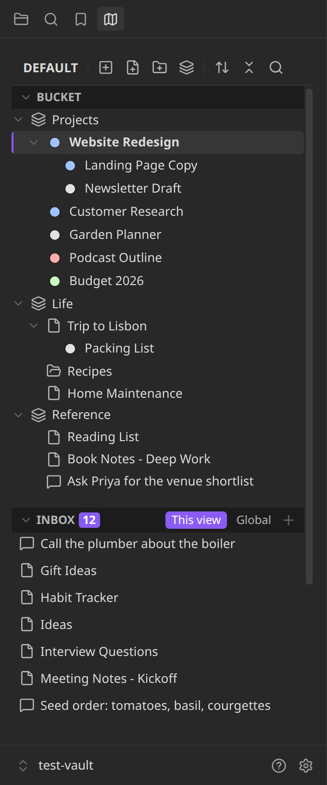

# Atlas Explorer

A replacement file explorer for Obsidian that shows every meaningful unit in your vault (blocks, files, folders) as one flat list, and lets you arrange those units into as many hierarchies as you like, without ever moving anything on disk.

**Version 0.10.0.** Available in Obsidian's community plugins: open **Settings → Community plugins → Browse**, search for **Atlas Explorer**, then install and enable it. It needs Obsidian 1.13.1 or later. It is built to work on mobile too, but has not been tested on a device, and a few features are desktop only (the pages say which). The source is at [github.com/danrfletcher/atlas-explorer](https://github.com/danrfletcher/atlas-explorer).

## Why

Folder paths do two jobs at once: they say what a thing *is* (stable) and what status it *has* (changes constantly). Every status change means a move, and every move breaks relative links and anything wired to that path. Atlas separates the two jobs. The folder hierarchy on disk stays fixed, and you arrange things into any number of named **views**: drawings over the vault, not addresses for it. Rearranging becomes editing a drawing, and nothing underneath moves.

## Read next

| Page | What's in it |
|---|---|
| [Concepts](concepts.md) | Units, free blocks, modules, views, the bucket and the inbox, and the rules Atlas never breaks. |
| [Using the explorer](using-the-explorer.md) | The toolbar, rows, menus, drag and drop, multi-select, keyboard, the inbox, creating and swapping items, the `[[` link suggester. |
| [Statuses](statuses.md) | Status sets, assigning them to an item's children, hiding, truncating, and clicking a dot to change one. |
| [Sorting and reordering](sorting.md) | Manual, A-Z, Modified, Time added and Status sorts; drag-to-reorder rules. |
| [Data sources](data-sources.md) | Fill a Folder, or any bucket item, from an API, a vault folder (or one outside the vault), a CSV file or a Markdown table. |
| [Settings and commands](settings.md) | Every setting and every command-palette command. |
| [MCP server](mcp-server.md) | The optional local server that lets an agent read and arrange your views. |
| [decisions.md](decisions.md) | Every judgement call made during the build, the alternatives considered, and why. |

## What Atlas never does

- **Arranging never touches disk.** Placing, nesting, reordering, sorting, duplicating, removing from a view and swapping only edit Atlas's own data (`data.json` in the plugin folder).
- **Atlas never edits the content of your notes.**
- The only things that create or move files are the ones you ask for by name. See [When Atlas touches your files](concepts.md#when-atlas-touches-your-files).
