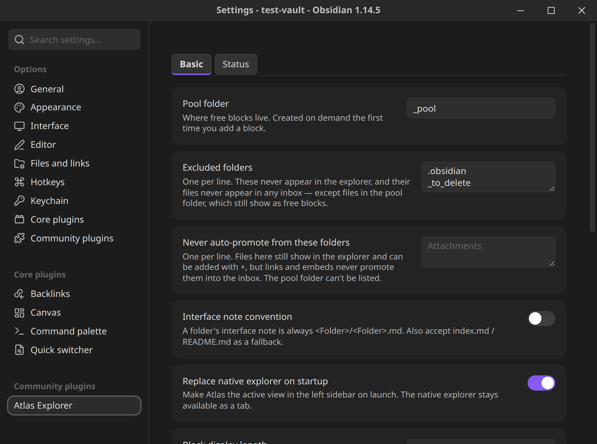

[Atlas Explorer](index.md) › Settings and commands

# Settings and commands

Open **Settings → Atlas Explorer**. The panel has two tabs, **Basic** and **Status**. The screenshot shows the top of the Basic tab.

## Basic

| Setting | Default | What it does |
|---|---|---|
| Pool folder | `_pool` | Where [free blocks](concepts.md#free-blocks) live. Created on demand the first time you add a block. Changing it re-indexes and warns about blocks left behind in the old folder. |
| Excluded folders | dot-folders, the pool folder, `_to_delete` (worked out on first load) | One per line. These never appear in the explorer, and their files never appear in any inbox, except files in the pool folder, which still show as free blocks. |
| Never auto-promote from these folders | empty | One per line. Files here still show in the explorer and can be added with **+**, but links and embeds never promote them into the inbox. Promotion by hand, units and placement are unchanged. The pool folder can't be listed. |
| Interface note convention | `<Folder>/<Folder>.md` | Toggle to also accept `index.md` / `README.md` as a folder's interface note. |
| Replace native explorer on startup | on | Makes Atlas the active view in the left sidebar on launch. The native explorer stays available as a tab. |
| Block display length | 80 | How many characters of a free block's first line to show in the explorer. |
| Confirm before adding a unit to a module | on | Ask before a drag onto a module's icon physically files something into it. Off skips the confirmation, not the move. |
| Highlight the open note | on | Gives the row(s) for the note open in the editor a visible highlight. |
| Default view on launch | Default | Which view Atlas opens to when the vault loads. |

### MCP server

Off by default, and desktop only. See [MCP server](mcp-server.md) for what it offers. In settings: **Enable MCP server**, **Port** (default `27202`, per device), and **Token** (with a **Regenerate** button). On mobile this section just says the server runs on desktop only.

## Status

Status sets, the shared color palette, and the Glow, Retain icons and Retained icon color options. See [Statuses](statuses.md).

## Commands

Open the command palette and search for "Atlas Explorer".

| Command | What it does |
|---|---|
| `Atlas Explorer: Add block` | Creates a new free block in the pool folder and opens it with the cursor ready to type, with no filename prompt. |
| `Atlas Explorer: Open explorer` | Opens or focuses the Atlas view in the left sidebar. |
| `Atlas Explorer: Switch view…` | Fuzzy-picks another view and makes it active. |
| `Atlas Explorer: Place active file in view…` | Fuzzy-picks a view, then a folder (or the bucket root) within it, and places the active file there: the keyboard and mobile equivalent of dragging it in. |
| `Atlas Explorer: Reveal active file in Atlas` | Opens the explorer and, if the active file isn't placed anywhere, says so. |
| `Atlas Explorer: New view` | Prompts for a name and creates a new, empty view. |
| `Atlas Explorer: Rebuild index` | Forces a full re-scan of every unit in the vault, and logs timings to the console. |

Everything else is on the explorer's right-click menus; see [Using the explorer](using-the-explorer.md). There are no default hotkeys.

## Where Atlas keeps its data

In the plugin's `data.json`: your settings, views and their trees, manual promotions, dismissed and added items, status sets and the data-source configuration and cached rows. Two things are deliberately kept on the device only and never synced: **API headers** and **outside-the-vault folder paths** (both can hold things that are specific to one machine or secret), and the MCP port and token.
